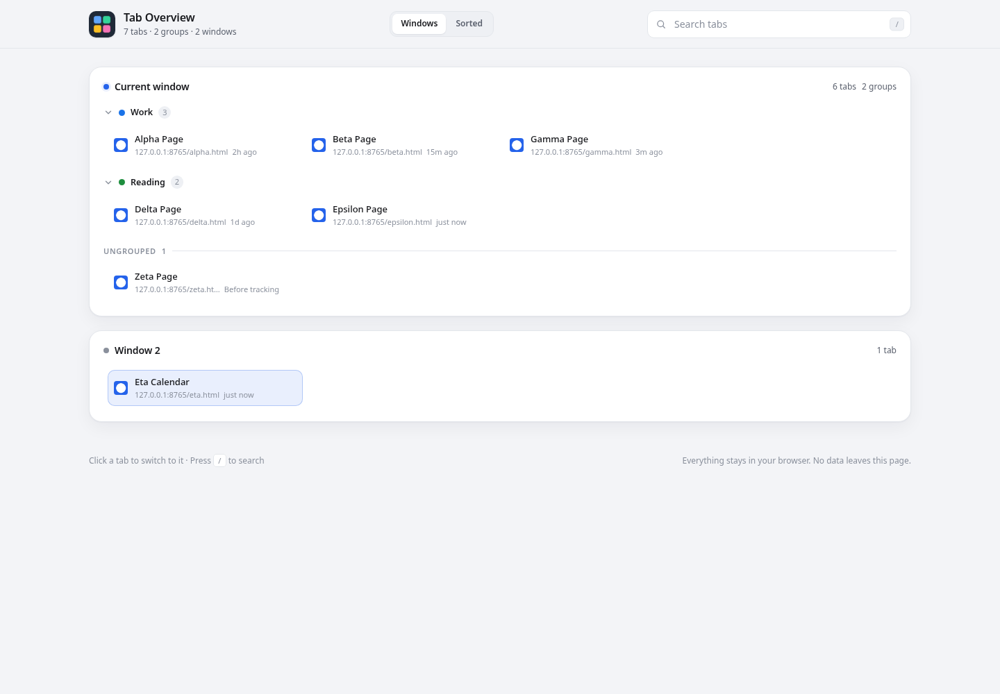
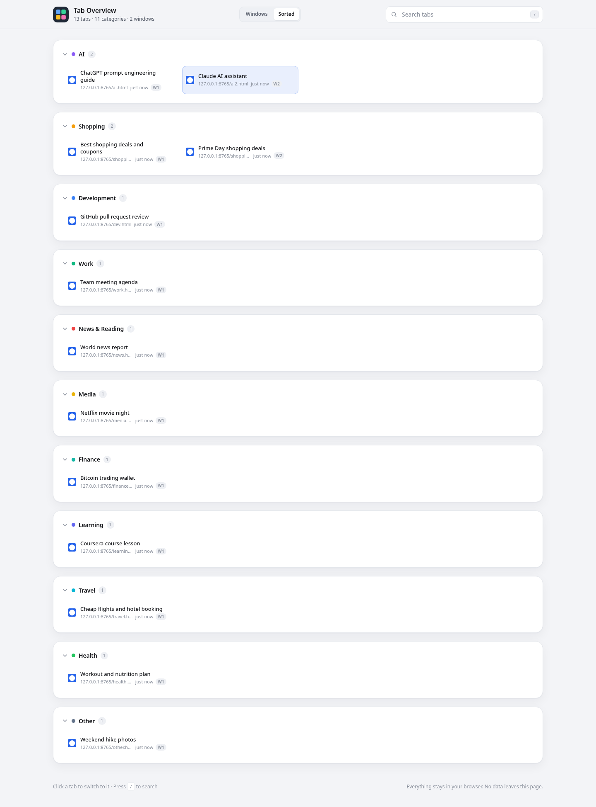

# Tab Overview

A Chrome/Brave extension that replaces the new tab page with an overview of every
open tab, tab group, and window. Everything runs locally.





## Is this feasible?

Yes. Chrome has supported new tab page overrides for years, and Manifest V3 exposes
everything this needs:

| What | API |
| --- | --- |
| Replace the new tab page | `chrome_url_overrides.newtab` in `manifest.json` |
| Read tabs, titles, URLs, windows | `chrome.tabs` + `chrome.windows` (`"tabs"` permission) |
| Read tab groups and colors | `chrome.tabGroups` (`"tabGroups"` permission) |
| Track when tabs were opened | `chrome.tabs.onCreated` + `chrome.storage.session` (`"storage"` permission) |
| Local favicons | `chrome-extension://<id>/_favicon/` (`"favicon"` permission) |

No host permissions and no network access are required. Brave, Edge, and other
Chromium browsers support the same manifest and APIs.

## Install

1. Open `chrome://extensions` (or `brave://extensions`).
2. Turn on **Developer mode**.
3. Click **Load unpacked** and choose this folder.
4. Open a new tab.

If you later change the files, click the reload button on the extension card.

## Features

- Every window, with the current window first.
- A **Sorted** view that groups all tabs across windows by category: AI,
  Shopping, Development, Work, News & Reading, Social, Media, Finance,
  Learning, Travel, Health, and Other.
- Tab groups shown with their Chrome title and color.
- Shows how long ago each tab was opened, with the exact time in the tooltip.
- Pinned, audible, muted, and sleeping (discarded) tabs are marked.
- Click a tab to switch to it and focus its window.
- Close a tab with the × button, or middle-click the tab card.
- Search by tab title, URL, or group name. Press `/` anywhere to focus search.
- Collapse a group in the overview; the state is remembered locally. This does
  not change the group's collapsed state in the browser's tab strip.
- Collapse a category in the sorted view; the state is remembered locally.
- The selected view and collapse choices persist across page loads.
- Live updates as tabs are opened, closed, moved, grouped, or renamed.
- Automatic light and dark theme.

## How the sorted view categorizes tabs

Categories are decided locally from the tab's hostname and title/URL keywords.
Known domains carry more weight than keywords, and topic keywords can override
generic news or social domains. For example:

- An Amazon product page stays in Shopping even if its title mentions AI.
- An AI article on a news site goes to AI.
- A GitHub repository stays in Development unless its title is strongly AI-related.
- Unknown sites fall back to title keywords, then Other.

Nothing reads the page content, makes a network request, or sends data anywhere.
The rules live in `categories.js`, so you can add domains or keywords there.

## Permissions and privacy

- `tabs` — read tab titles, URLs, favicons, and window membership. Chrome shows
  this as "Read your browsing history" at install time. The extension never
  stores or transmits that data.
- `tabGroups` — read tab group titles, colors, and membership.
- `favicon` — load favicons from Chrome's local favicon cache. No favicon
  requests are made to websites.
- `storage` — keep tab open timestamps in session storage. This data is cleared
  when the browser exits and never leaves the machine.

The background service worker records tab open times and removes them when tabs
close. There are no analytics, no external requests, and no host permissions. The
page reads browser state when it opens and listens for local tab events while it
is visible.

## Limitations

- Chrome does not expose window names, so windows are labeled "Current window",
  "Window 2", and so on.
- Only the current browser profile is visible. Other profiles and incognito
  windows are separate; enable **Allow in Incognito** on the extension card if
  you want the overview there.
- The new tab page itself is excluded from the list.
- If another extension also overrides the new tab page, Chrome only allows one.
- Chrome does not expose the original creation time of tabs that were already
  open before the extension was installed or before the browser restarted. Those
  tabs show "Before tracking". New tabs are tracked precisely from the moment
  they open.
- Categorization is a heuristic, so a page can land in the wrong category. Edit
  `categories.js` to tune the domain and keyword rules.
- A browser restart restores the tab group state from Chrome's session; the
  overview's local group-collapse choices are stored in `localStorage`.

## Files

```
manifest.json     Manifest V3 definition, new tab override, and background worker
background.js     Records tab open times and cleans them up
categories.js     Domain and keyword rules for the sorted view
newtab.html       Page shell
newtab.css        Light/dark responsive styling
newtab.js         Data loading, rendering, search, views, and tab actions
icons/            Extension icons (SVG source + PNG sizes)
screenshot.png    Window view preview
screenshot-sorted.png  Sorted view preview
```

## License

MIT — see [LICENSE](LICENSE).
